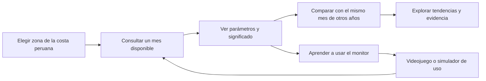

# Evolución de Chaski Polar: paquete 1 para pesca artesanal

Fecha: 14 de noviembre de 2026. Alcance corregido según la decisión del equipo.

Leer también: [Visión y necesidad del producto](REPORTE_VISION_PESCA_ARTESANAL.md). Para el alcance de esta entrega prevalece este plan: el reporte de visión conserva antecedentes de la propuesta completa.

## 1. Tres productos separados

| Paquete | Qué incluye | Estado |
| --- | --- | --- |
| **1. Monitor y aprendizaje** | Monitor mejorado, parámetros explicados, consulta histórica y videojuego/simulador para aprender a usar la página | **Única entrega activa** |
| **2. Predicción ambiental** | Pronóstico de variables abióticas con un mínimo de siete días, mediante ecuaciones diferenciales y/o aprendizaje automático | Producto posterior, fuera de esta implementación |
| **3. Cuentas y reportes** | Usuarios, embarcaciones, expediciones y posibles mapas colectivos | **No se lanzará en esta entrega** |

El paquete 1 debe tener valor completo por sí mismo. No depende de cuentas, registros de pesca ni predicciones. La pantalla principal no tendrá accesos vacíos a esos productos ni presentará escenarios como pronósticos.

## 2. Qué queremos resolver ahora

Un pescador artesanal debe poder elegir su zona, consultar una fecha, entender los parámetros disponibles y comparar cómo se comportó el mar. El videojuego/simulador debe enseñarle a usar esas mismas herramientas y a interpretar sus límites.

Promesa del paquete 1: **«Conoce el mar de tu zona y aprende a leer sus cambios»**.

La consulta rápida está disponible sin jugar. El simulador es una forma opcional de aprender; no es un modelo validado de captura, profundidad de pesca o rentabilidad.

## 3. Copias de trabajo

- `chaski-polar-webpage-old/`: referencia de la página anterior; no editar.
- `chaski-polar-webpage/`: copia activa para todos los cambios nuevos.
- `data_treatment/`: análisis y documentación; este informe vive en `docs/`.

Los cambios de interfaz reutilizarán los datos existentes. No se modificarán los archivos científicos para acomodarlos al diseño. Las fuentes, las fechas y la cobertura deben conservarse.

## 4. Experiencia del paquete 1

### Pantalla principal del monitor

1. **Mi zona:** cinco áreas costeras disponibles, identificadas por nombre y región. La posición de referencia no representa un punto recomendado de pesca.
2. **Fecha de consulta:** mes y año visibles. Usar «último dato disponible» en lugar de «hoy» cuando la información sea histórica.
3. **Parámetros:** nombre sencillo, valor, unidad, fuente, alcance espacial y disponibilidad para la fecha elegida.
4. **Qué significa:** explicación corta, relación con el ecosistema y lo que el dato permite interpretar.
5. **Historia:** gráfico legible, comparación con el comportamiento habitual de ese mes y periodos de consulta.
6. **Aprender:** tutorial de la interfaz y acceso al videojuego, sin bloquear la consulta.

El monitor es la entrada práctica. El globo y los análisis extensos quedan disponibles en la exploración científica; no deben ser requisitos para consultar un parámetro en el celular.

### Parámetros y cobertura

| Grupo | Presentación |
| --- | --- |
| Temperatura superficial | Calor del agua en superficie; °C; explicar la comparación estacional |
| Clorofila-a | Pigmento que sirve como indicador de fitoplancton; mg/m³; no equivale a captura |
| Viento y corrientes | Identificar origen, periodo y que sus promedios mensuales no describen una faena puntual |
| Salinidad y transparencia | Explicar sal y atenuación de luz con lenguaje cotidiano |
| Oxígeno y nutrientes regionales | Identificar expresamente que representan el dominio peruano, sin atribuirlos a una caleta |
| Otros indicadores disponibles | Ofrecerlos mediante consulta progresiva con sus límites y unidades |

La consulta no debe reemplazar un dato local faltante por uno regional sin identificar el cambio. Cero es un valor válido y no equivale a ausencia. No trasladar el último valor antiguo al mes seleccionado. Si una corriente termina en 2018, una consulta en 2026 mostrará falta de dato y su última fecha disponible.

Comparar con el mismo mes calendario evita confundir el verano con el invierno. El periodo de referencia y el número de observaciones utilizadas deben estar visibles. Una diferencia con la media mensual no constituye una prueba de tendencia ni de significancia.

### Celular y accesibilidad

- Español como idioma principal del nuevo monitor para el público artesanal. La exploración científica existente puede conservar su idioma.
- Controles táctiles amplios, tipografía legible, contraste alto y diseño desde 320 px.
- Selector de zona y fecha accesibles sin navegar el globo.
- Gráficos que se adapten al ancho y alternativa tabular para consultar cifras.
- Explicaciones desplegables y tutorial omisible/reabrible.
- Mostrar carga, error, falta de datos y fechas antiguas con mensajes claros.
- Guardar preferencias solo en el dispositivo si resulta útil; no crear cuentas.
- Respetar reducción de movimiento y navegación por teclado.

## 5. Videojuego/simulador de uso

La meta del paquete 1 es aprender a utilizar la página. Cardumen puede conservar su experiencia ecológica, pero su evolución debe vincular acciones con controles reales del monitor.

| Momento | Acción que aprende el usuario | Relación con la página |
| --- | --- | --- |
| Elegir una zona | Diferenciar costa y ámbito regional | Mismo selector o nombres |
| Consultar un mes | Leer fecha y distinguir histórico de presente | Mismo calendario |
| Elegir un parámetro | Reconocer unidad y significado | Misma ficha explicativa |
| Comparar valores | Contrastar el mismo mes entre años | Mismo gráfico y referencia |
| Interpretar | Reconocer ausencia de datos y límites | Mismos estados y mensajes |

Primera entrega de aprendizaje: una guía corta dentro del monitor para practicar estas acciones. La adaptación completa del videojuego/simulador es una tarea identificada para los compañeros; no se considerará terminada por añadir un enlace al juego anterior.

No introducir en esta versión ejercicios de pronóstico semanal, registro de barcos o bitácoras. Las consecuencias ecológicas ilustrativas del juego deben conservar su rótulo. La narrativa antártica no debe presentar una conexión directa con Perú como demostrada.

Fuente científica principal: [Reporte consolidado de resultados](pruebas_pendientes/REPORTE_CONSOLIDADO_RESULTADOS.md). Las asociaciones El Niño–ambiente/pigmento no permiten recomendar cantidades de embarcaciones ni garantizar capturas.

## 6. Cambios por componente

| Componente | Trabajo del paquete 1 | Entregable |
| --- | --- | --- |
| Monitor | Consulta costera prioritaria, valores, fechas y explicaciones | Pantalla usable en escritorio y teléfono |
| Navegación | Entrada directa al monitor y acceso claro a aprendizaje/investigación | Recorrido comprensible sin portada 3D obligatoria |
| Datos | Leer series existentes y conservar fuente/alcance | Adaptador de consulta sin editar datos originales |
| Comparación histórica | Referencia por mes, periodos y tabla accesible | Interpretación reproducible, sin rellenar huecos |
| Tutorial | Enseñar zona, fecha, parámetro y comparación | Guía omisible que utilice los controles reales |
| Videojuego | Diseñar e integrar el simulador de uso | Misión conectada; trabajo independiente del rediseño del monitor |
| Exploración científica | Conservar tendencias y fuentes | Acceso al material que responde al desafío |

Una API pública es una posible forma posterior de distribuir la información del paquete 1, no un requisito para mejorar la consulta actual. No crear backend, autenticación ni base de expediciones como dependencia de esta entrega.

## 7. Responsabilidades para el equipo

| Frente | Trabajo inmediato | Criterio de aceptación |
| --- | --- | --- |
| Diseño y textos | Prioridad de parámetros, español y composición móvil | Usuario identifica valor, fecha y significado |
| Datos y ciencia | Revisar unidades, referencia histórica, cobertura y procedencia | Ningún dato regional se confunde con uno local |
| Frontend | Monitor, selectores, gráficos, tabla y estados | Cambios de zona/fecha consistentes y sin desbordamiento móvil |
| Juego y aprendizaje | Simulador de uso y vínculo con monitor | Aprendizaje demostrable, no solo acceso al juego |
| Validación e integración | Revisar dispositivos y recorrido completo | Controles táctiles, teclado, errores y datos faltantes funcionan |

El frente de backend/cuentas queda fuera. No asignar tareas del paquete 2 o 3 dentro del tablero de implementación del paquete 1.

## 8. Orden de entrega

1. Reordenar este informe y acordar el alcance.
2. Construir la nueva entrada del monitor con los datos existentes.
3. Añadir fichas de significado, fechas, origen y comparación histórica.
4. Revisar escritorio, celular y accesibilidad.
5. Diseñar/integrar con los compañeros el videojuego como simulador de uso.
6. Validar con pescadores artesanales de una zona concreta.

Demostración: elegir zona, consultar mes, entender parámetros, comparar una serie y practicar el uso. Mantener acceso a tendencias, magnitud de cambio, significancia y fuentes NASA para responder al desafío.

## 9. Criterios para dar por listo el monitor

- La consulta principal se entiende en español y funciona a 320–390 px sin desplazamiento horizontal.
- Zona, fecha, parámetro y periodo cambian los resultados correctos.
- Las variables muestran su unidad, significado y procedencia.
- Los datos de distinta cobertura no aparecen como si todos fueran de la caleta.
- Las ausencias no se interpolan ni se sustituyen por cero.
- Se distingue el periodo histórico del estado actual del mar.
- El tutorial puede completarse, omitirse y abrirse otra vez.
- La exploración anterior y el juego siguen siendo accesibles.
- Compilación y lint no introducen errores; se revisan las interacciones en navegador.
- La copia `chaski-polar-webpage-old/` y los datos científicos permanecen sin cambios.

## 10. Paquetes futuros: fuera del trabajo activo

### Paquete 2 — predicción de al menos siete días

Investigar y validar predicción de variables abióticas mediante ecuaciones diferenciales y/o aprendizaje automático. Necesita entradas con resolución temporal adecuada, condiciones iniciales y forzamientos cuando proceda, separación temporal de entrenamiento/prueba y comparación frente a persistencia y modelos operativos externos. Una regresión mensual o un escenario ilustrativo no cumplen este objetivo. El método y las métricas se desarrollarán en un plan separado cuando se active este paquete.

### Paquete 3 — cuentas y reportes

Incluye potencialmente cuentas, permisos, embarcaciones, expediciones y agregados de reportes. **No se lanzará en esta entrega.** No crear pantallas, formularios ficticios, base de datos ni navegación anticipada para este paquete.

Los planes anteriores que intercalaban estos módulos o proponían implementarlos en paralelo quedan sustituidos por esta separación de alcance.
